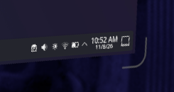
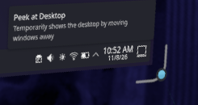

# Resize corners

### Defaults and original mode

The default is **SteamOS-like**, with **only bottom-right always shown**, preview off, **27% opacity**, **4.7 cm arms**, **5.1 mm thickness**, **3.1 cm requested gap**, and **2.4 cm hover padding**. Roundness remains 100%, screen exclusion 0.5 cm, and approach radius 20 cm. Existing saved choices take precedence.

**Soft glow (original behavior)** is a true legacy mode: the unchanged soft-glow renderer and original distance-based proximity fade, a square hit area sized at 1.8 times the current button size just outside the selected corner, the original automatic corner selection, and the original near-hand tab behavior. It does **not** use the new opacity/colors, gap, shape padding, screen exclusion, roundness, animated growth, target preview or always-visible corner choices. Those controls are disabled without erasing their saved values, so switching back restores your preferences. The legacy square/proximity is intentionally not the new shaped hit region.

**Hover haptics** is optional and **on by default** (`RESIZE_CORNER_HAPTICS=1`), including in original mode. A short pulse is sent only to the physical controller whose laser enters the actual resize hover target, once per entry/controller change—not continuously while hovering. It never sends to the other controller, 3D mouse, gaze or near hands; approaching the preview alone does not buzz. Disable the checkbox for fully silent legacy behavior.

### Modern outline styles

The **SteamOS-like (gray → white)** style approximates SteamVR's feedback: gray while approaching, almost white when actually hovered/held, with 12% longer arms, a 20% thicker stroke and 3 mm extra clearance. Hover animation does not move the hit area or overwrite custom colors; switch back to Sharp outline to use those colors. **Corner roundness** runs from 0% (square bend) to 100% (fully rounded); saved as `RESIZE_CORNER_ROUNDNESS` (default 100). SteamOS-like is saved as `RESIZE_CORNER_STYLE=native`. This is Frametop's own rendering, not SteamVR's native control.

Frametop's modern resize indicator is a crisp, rounded outline outside the panel, rather than a diffuse white halo. It follows whichever of the four corners a laser or hand approaches, in addition to any always-visible corners. SteamVR's native windows keep their own controls.

In **Display Settings → Visibility & pins → Resize corners**, choose **Sharp outline** or **SteamOS-like**, color and opacity. The modern corner path has arm length (1–10 cm), thickness (0.5–6 mm), and a requested gap from the panel (0–10 cm). The target follows this path. Hover growth, outward movement and color changes ease in and out over 180 ms, reversing smoothly if the pointer leaves midway inside a stable target.

**Preview resize hover targets** draws a translucent padded band following both arms, the rounded bend and endpoints—not a box or the larger approach radius. Its pixels come from the same region used for controller masks and 3D-mouse filtering. The preview itself never intercepts input. **Always show top-left / top-right / bottom-left / bottom-right corner** are four independent checkboxes: any combination, all, or none; only bottom-right is on by default. These keep feedback and enabled previews visible only while the panel itself is visible; hidden, minimized or paused panels stay hidden. Unchecked corners still show automatic approach feedback. These choices affect appearance, not which corners can resize. The interactive target continues to follow the approached corner.

**Hover padding around outline** adds padding around the whole stroke (0.1–10 cm, default **2.4 cm**). **Screen exclusion margin** forbids laser resizing on the screen and a surrounding safety margin (0–5 cm, default **0.5 cm**). The requested outline gap automatically increases when necessary to keep its entire padded, animated target outside that exclusion zone. A bounded primitive approximation encloses the whole animation, so the target never shifts or shrinks under the pointer. **Approach preview radius** controls when feedback starts appearing (1–50 cm, default **20 cm**, at least the target extent). Actual target hover turns the sharp outline cyan, thickens it by 60% and reaches full configured opacity. It remains highlighted while resizing. **Ready-to-drag color** is configurable. Near-hand interaction distances remain separate; hand corners highlight when a pinch is eligible.

Changes apply live and persist as `RESIZE_CORNER_STYLE` (`sharp`/`native`/`glow`), `RESIZE_CORNER_COLOR` (`#f6f9ff`), `RESIZE_CORNER_OPACITY` (0.27), `RESIZE_CORNER_LENGTH` (cm), `RESIZE_CORNER_WIDTH` (mm), `RESIZE_CORNER_GAP` (cm), `RESIZE_CORNER_PADDING` (cm), `RESIZE_CORNER_EXCLUSION` (cm), `RESIZE_CORNER_REACH` (cm), `RESIZE_CORNER_HOVER_COLOR` (`#66ddff`), `RESIZE_CORNER_PREVIEW` (0/1), `RESIZE_CORNER_HAPTICS` (0/1), and `RESIZE_CORNER_ALWAYS_TL`, `RESIZE_CORNER_ALWAYS_TR`, `RESIZE_CORNER_ALWAYS_BL`, `RESIZE_CORNER_ALWAYS_BR` (each 0/1). The obsolete square-size key `RESIZE_CORNER_TARGET` is ignored rather than being interpreted as padding. In modern styles, zero opacity hides the indicator without disabling resizing; the diagnostic target preview has its own checkbox. Saved thickness values remain intact. Edge, button and touch feedback are unchanged.

## Headset screenshots

Wearer-approved, native-size crops of the SteamOS-like corner, with the target preview off.

Idle:

Controller laser hovering the actual resize target:

These are cropped OpenVR headset screenshots, not optical lens captures. Only these approved crops are published; raw captures remain private.
